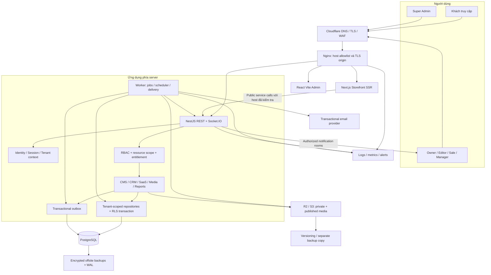

# SHOWORA — System Architecture

Ngày: 02/11/2026 · Phiên bản: 0.2 · **Kiến trúc đích; nền tảng Sprint 1 đã có implementation local**.

> Trạng thái code thực tế: [báo cáo Sprint 1](SPRINT_1_REPORT.md). Những module chưa được liệt kê là thiết kế cho giai đoạn tiếp theo.
## 1. Quyết định kiến trúc đề xuất

| Quyết định | Lý do và giới hạn |
|---|---|
| Modular monolith NestJS | Transaction nhất quán cho SaaS/CRM, triển khai MVP đơn giản; chưa cần microservices |
| React + Vite cho admin | React Router, TanStack Query, React Hook Form, Zod, Tailwind và Shadcn UI |
| Next.js riêng cho storefront | React SSR cho SEO/tenant động; cache có tenant key, không render dữ liệu private vào public |
| PostgreSQL + Prisma | Shared database/shared schema, foreign keys tenant-aware, transaction và RLS bổ sung |
| Worker cùng codebase API | Outbox PostgreSQL, reminder, email, scheduled publish, import/export; chưa thêm Redis/BullMQ |
| Socket.IO một API instance ở MVP | Thông báo bền trong DB; socket chỉ là kênh cập nhật. Multi-instance cần adapter/pubsub được duyệt trước |
| R2 hoặc S3-compatible qua adapter | Private upload/quarantine, công khai asset đã duyệt; không khóa cứng provider |
| Cloudflare → Nginx → containers trên VPS | TLS, reverse proxy, rate limit nhiều lớp; staging/production và secret tách biệt |

Next.js là lựa chọn trong stack public được brief cho phép; không thay Vite của admin. Phiên bản Node LTS, pnpm và dependencies được pin khi bootstrap sau phê duyệt, kèm kiểm tra tương thích; chưa chọn số phiên bản giả định.

## 2. System Architecture Diagram



Mũi tên là giao tiếp logic; kết nối DB/storage không mở ra Internet. Browser gọi `/api/v1` cùng origin; Nginx proxy vào API. Socket dùng `/socket.io` cùng origin. Kết nối storefront server → API phải đi qua trusted internal route, có service authentication và host gốc đã được proxy xác thực, không tin header do visitor gửi trực tiếp.

## 3. Host và tenant context

### Public request

1. Cloudflare/Nginx nhận host, loại host header trùng/malformed, chuẩn hóa lowercase, IDNA, bỏ port theo rule và kiểm tra binding. Origin chỉ cho phép đường truy cập tin cậy; `X-Forwarded-Host` từ client phải bị xóa/ghi lại.
2. Resolver tìm `tenant_domains` với `verified_at` và trạng thái active; domain chưa biết trả 404, không fallback sang tenant mặc định.
3. Public endpoint lấy tenant từ host đã xác minh; chỉ truy vấn published, không nhận tenant ID từ body/query. Platform host không được phục vụ public tenant content.
4. Cache key gồm canonical tenant ID, domain, locale, route, query đã chuẩn hóa và content version. Cache không chia sẻ theo pathname đơn lẻ.

### Authenticated admin request

- Tenant host có login riêng. JWT chứa `sub`, `sid`, `membershipId`, `tenantId`, `aud`, `iss`, `jti`, `exp` và version quyền; được ký bởi server.
- Backend kiểm tra chữ ký, session chưa revoke, membership active, tenant trạng thái hợp lệ và quyền hiện tại; `tenantId` trong token không thay cho kiểm tra membership.
- Host tenant phải khớp tenant trong context. Mismatch trả lỗi chung, không tự chuyển tenant hoặc rò rỉ tên tenant khác.
- Platform host chỉ nhận platform audience; tenant token không truy cập `/platform`. Đổi tenant yêu cầu bootstrap/đăng nhập tại tenant host đích và xác minh membership, không đổi `tenantId` tùy ý.
- Account-level endpoints đăng ký/xác minh email có allowlist route riêng; không gán một tenant mặc định để vượt guard.

### Custom domain

Owner khai báo domain → server sinh challenge DNS TXT → kiểm tra ownership và domain global uniqueness → kiểm tra DNS routing → cấp/kiểm tra TLS → activate binding. Chưa xác minh không route vào tenant. Không server-fetch URL tùy ý; kiểm tra DNS hạn chế SSRF/rebinding. Khi detach phải revoke mapping/certificate route và purge cache; không tự nhận domain từng thuộc tenant khác.

## 4. Cô lập dữ liệu nhiều lớp

1. **Request context:** tenant và actor được xác thực ở guard, không nhận từ DTO nghiệp vụ.
2. **Authorization:** permission + resource scope (own/team/all) + entitlement trước khi xử lý. Frontend chỉ hỗ trợ UX.
3. **Repository:** mọi tenant read/write bắt buộc truyền `TenantContext`; `findUnique(id)` không scope bị cấm. Update/delete dùng `(tenant_id, id)` cùng version khi cần.
4. **Ràng buộc DB:** composite foreign keys `(tenant_id, foreign_id)` ngăn liên kết chéo tenant; unique slug tenant-local; Prisma schema và SQL migrations giữ cùng semantics.
5. **RLS:** bảng tenant-owned bật `ENABLE` và `FORCE ROW LEVEL SECURITY`; cả `USING` và `WITH CHECK`. App runtime không là owner/superuser và không `BYPASSRLS`.

Mỗi request/job có DB transaction dùng `set_config('app.tenant_id', ..., true)` từ trusted context; thiếu context phải fail closed, không trả toàn bảng. Chỉ gọi Prisma qua transaction client đó, không set session-level context vì connection pool có thể tái sử dụng giữa tenant. Runtime role không được tắt RLS hoặc đổi role. Migration role tách riêng, không dùng làm credential API.

RLS tenant-level không thay thế quyền own/team; repository vẫn lọc Lead theo scope và kiểm tra đối tượng con (note, attachment, quotation, reminder). Platform chỉ truy cập bảng SaaS qua repository riêng và DB grants tối thiểu. Tác vụ tenant của platform phải chỉ định context đã được kiểm tra, có audit và quyền rõ ràng; không có “global bypass” trong pool API. Aggregate usage lấy từ bảng billing/usage được cấp quyền, không đọc CRM PII xuyên tenant.

Dashboard/list billing xuyên tenant dùng platform read connection riêng, chỉ được SELECT các read-model views có allowlist cột SaaS. Các bảng SaaS cần thiết có RLS SELECT policy riêng cho role đọc nền tảng, được review rõ từng bảng; role này không có quyền CMS/CRM/users/private media, không UPDATE và không BYPASSRLS. Tenant runtime role không được truy cập các views/pool này. Platform mutation vẫn mở transaction với đúng target tenant sau platform guard; không có write policy bỏ qua tenant. Kiểm thử phải chứng minh tenant route không gọi được platform repository và read model không chứa PII CRM.

## 5. Các module và dependency

| Module | Sở hữu | Phụ thuộc cho phép |
|---|---|---|
| Identity | users, sessions, refresh, verify/reset | Email qua outbox |
| Tenancy | tenants, domains, memberships, invitations, teams | Identity, RBAC, Entitlement |
| Authorization | roles, permissions, scope policies | Membership và team context |
| Subscription/Billing | plans, versions, subscriptions, invoices, transactions, coupons | Usage, PaymentProvider |
| Catalog | products, categories, brands, dynamic attributes | Media, Entitlement, SEO |
| Content | pages, blogs, projects, banners | Media, Catalog references, SEO |
| Website | settings, navigation, domain presentation | Published read models, SEO |
| CRM | leads, assignments, history, notes, reminder, quotations | Membership/team, Catalog references, Notifications |
| Media | asset lifecycle, storage reservations | Storage adapter, Entitlement |
| Analytics/Reports | visit events, aggregate reports | Scoped published/CRM queries |
| Notifications | durable notification và outbox deliveries | Identity receiver, tenant context |
| Audit | append-only events đã redact | Actor/context, không chứa full PII |

Module không import repository nội bộ của module khác; dùng service contract. Shared packages không import apps. Không đưa Prisma model thành public API type, không đưa config server/secret vào bundle frontend.

## 6. Monorepo dự kiến

```text
apps/
  admin/
    src/{app,features,lib}/
    # app: router/providers/layout; features: module UI + queries
  storefront/
    src/{app,features,lib}/
    # Next routes, SSR tenant resolver, metadata, sitemap
  api/
    src/{modules,common,worker}/
    prisma/{schema.prisma,migrations}/
    test/{integration,e2e}/
packages/
  shared-types/src/          # DTO contracts, enums; không Prisma runtime
  shared-validation/src/     # Zod schemas an toàn cho client; server kiểm tra lại
  ui/src/                    # Shadcn wrappers, semantic tokens, patterns
  config/                    # tsconfig strict, lint, build conventions
infrastructure/
  docker/                    # multi-stage Dockerfiles, compose local/prod
  nginx/                     # host routing, TLS, headers, proxy limits
  scripts/                   # deploy, backup, restore, health, rollback
.github/workflows/           # CI và môi trường deploy có approval
docs/
  PRD.md
  ARCHITECTURE.md
  DATABASE_ERD.md
  API_SPEC.md
  SECURITY.md
  DEVELOPMENT_ROADMAP.md
  UI_UX_SPECIFICATION.md
  # DEPLOYMENT.md và TESTING.md bổ sung trong sprint triển khai
pnpm-workspace.yaml
package.json
pnpm-lock.yaml
```

Cây trên mô tả đích. Workspace hiện đã bootstrap apps/packages; module nghiệp vụ còn lại triển khai theo roadmap. Xem [báo cáo Sprint 1](SPRINT_1_REPORT.md). pnpm workspace filters giới hạn lệnh theo app/package. Pin package manager, dùng `pnpm install --frozen-lockfile` trong CI; không dùng npm/yarn. Mỗi feature tách route/controller, DTO, service, repository và policy vừa đủ; không gom toàn app vào một file.

## 7. Giao dịch và xử lý bất đồng bộ

### Lead capture

Rate limit + spam validation → resolve tenant/entitlement → normalize contact → kiểm tra idempotency/duplicate → lock quota → lưu Lead + history + audit tối thiểu + outbox cùng transaction → trả acknowledgment → worker tạo/deliver notification. Notification và assignment không được mất nếu process chết sau commit.

### Quota

Quota lấy từ subscription plan version và override được audit. Lock entitlement/usage row theo tenant + resource + period, kiểm tra và tăng trong cùng transaction với tạo resource; retry deadlock/serialization có giới hạn. Product quota tính bản ghi chưa soft-delete gồm cả draft; staff tính active + pending invite đã giữ chỗ; Lead quota tính Lead hợp lệ mới theo kỳ subscription; media tính bytes đã lưu + reservation. Worker không được bypass. Hủy/xóa giải phóng đúng một lần, không làm âm usage; reconcile job phát hiện drift.

### Outbox và scheduler

Outbox delivery là at-least-once, không hứa exactly-once. Worker claim bằng transaction/`FOR UPDATE SKIP LOCKED`, lease có hạn, retry backoff + jitter, unique deduplication key phía consumer và dead-letter có cảnh báo. Reminder/scheduled post có `run_at` UTC và kiểm tra lại membership/tenant/entitlement tại thời điểm chạy. Side effect ngoài DB dùng idempotency key để retry an toàn.

### Billing

`PaymentProvider` định nghĩa tạo yêu cầu thanh toán, kiểm tra trạng thái và xử lý event đã xác minh. MVP dùng ManualPaymentProvider. Xác nhận thủ công yêu cầu platform permission, lý do và reference; unique provider transaction ngăn gia hạn lặp. Invoice, transaction, subscription version và audit cập nhật trong transaction. VNPay/MoMo chỉ thêm sau khi có chữ ký webhook, replay defense và đối soát; chưa giả lập gateway.

## 8. SEO, nội dung và analytics

- Next SSR public API theo tenant, render title/description/canonical/Open Graph và JSON-LD đã escape. Product schema chỉ dùng thông số/giá được xác minh; kiểu CONTACT không bịa Offer price.
- Sitemap/robots tenant-local; noindex cho preview/draft/staging và trang admin. Redirect 301 từ bảng tenant-scoped, chặn vòng lặp và redirect ra host tùy ý.
- Publish/update/unpublish phát invalidation event gồm tenant và route; cache TTL là lớp fallback. Nội dung bị khóa phải bị vô hiệu hóa ở edge/cache, không chờ TTL dài.
- GA chỉ nhận measurement ID hợp lệ; GSC dùng verification token qua setting, không cho chèn script HTML tự do. CSP chỉ mở các provider đã được duyệt.
- First-party analytics thu dữ liệu tối thiểu và session ID không định danh theo chính sách consent. Chống bot và retention trước aggregate; dashboard hiển thị “chưa có dữ liệu” khi chưa đủ dữ liệu, không fake số.

## 9. Local, deployment và vận hành dự kiến

- Local: Node LTS/pnpm được pin, Docker PostgreSQL + S3-compatible local + mail sandbox. Đổi host bằng `*.localhost` nếu môi trường hỗ trợ hoặc hosts file cho platform và ít nhất hai tenant; tránh dùng header tenant tùy ý thay test hostname.
- Docker images chạy non-root; health `/health/live`, `/health/ready`; ready không tiết lộ credential và kiểm tra DB/migrations, dependency thiết yếu. Worker có heartbeat riêng.
- Nginx phục vụ admin assets, proxy Next/API/socket; Cloudflare Full (strict), HTTPS origin, WebSocket upgrade, giới hạn request size/timeouts và trusted proxy CIDRs.
- `dev` → staging, `main` → production qua CI xanh, protected branches và environment gate. Không deploy tự động từ máy local hoặc khi chưa có hạ tầng/secrets.
- Migration theo expand → backfill có kiểm soát → switch → contract ở release sau; migration chạy một job có lock trước rollout, không từ từng container.
- Rollback image trước chỉ hợp lệ nếu schema tương thích. Không tự chạy destructive down-migration; dùng forward fix hoặc restore được điều phối khi cần.
- Backup PostgreSQL base + WAL tối đa trễ 1 giờ và media backup/versioning; backup ngoài VPS, mã hóa, giám sát độ mới. Restore sang môi trường cô lập hàng tháng để đo RPO/RTO.
- Log JSON với request ID, tenant/actor ID nội bộ, status, latency; redact contact/token. Metrics API latency, errors, outbox lag, worker failure, disk, connection pool, usage drift và backup age. Alert phải có người nhận/on-call được chỉ định trước production.

## 10. Giới hạn và hướng mở rộng

Một VPS/một API instance là điểm lỗi đơn, không quảng cáo high availability. Khi số liệu chứng minh cần scale: replica API + Socket.IO adapter, worker riêng, DB managed/replication, CDN tuning; mọi thay đổi kiến trúc phải phân tích và được duyệt. Không thêm message broker, Kubernetes hoặc microservices chỉ vì dự đoán tải.

Các ràng buộc DB chi tiết ở [DATABASE_ERD.md](DATABASE_ERD.md); permission/API ở [API_SPEC.md](API_SPEC.md); threat model và release gate ở [SECURITY.md](SECURITY.md).
