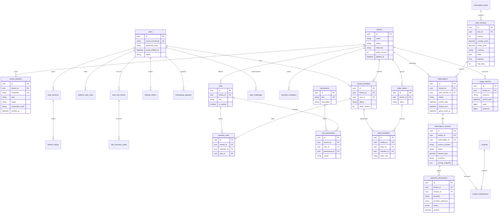
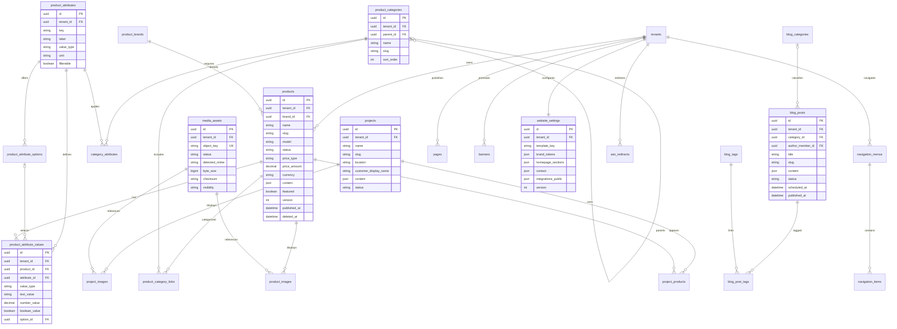
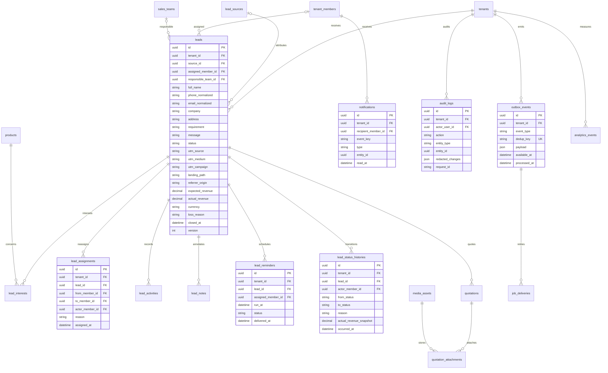

# SHOWORA — Database Design & ERD

Ngày: 02/11/2026 · Phiên bản: 0.2 · **ERD đích; identity/tenancy/RBAC có Prisma schema và migrations Sprint 1**.

> Trạng thái code thực tế: [báo cáo Sprint 1](SPRINT_1_REPORT.md). Những module chưa được liệt kê là thiết kế cho giai đoạn tiếp theo.
## 1. Quy ước và invariant

- PostgreSQL, UUID làm primary key, `timestamptz` lưu UTC. Tất cả bảng có `created_at`; bản ghi có thể sửa có `updated_at`. Bảng append-only không cập nhật nội dung nghiệp vụ.
- Bảng **T** thuộc tenant có `tenant_id NOT NULL`, FK đến tenants và `UNIQUE(tenant_id, id)`. Bảng **G** toàn cục được liệt kê riêng, không giả gán tenant mặc định. Bảng **A** thuộc danh tính/account có policy riêng.
- Mọi liên kết giữa hai bảng T dùng composite FK `(tenant_id, parent_id) → parent(tenant_id, id)`, kể cả media, assignee, category, author membership và join table. UUID khó đoán không thay thế kiểm soát truy cập.
- `users` là danh tính toàn cục; `tenant_members` là người dùng trong tenant. CRM gắn `member_id`, không gắn user ID đơn lẻ. Một role tenant không thể cấp SUPER_ADMIN.
- FK mặc định `RESTRICT`. Không cascade tenant → toàn bộ dữ liệu. Xóa vĩnh viễn chỉ qua purge job có retention, preview, backup và audit. Cascade chỉ cho join rows không có giá trị lịch sử, trong tác vụ được kiểm soát.
- `deleted_at` cho products, categories, brands, pages, posts, projects, leads và media khi cần; membership/role vô hiệu hóa thay vì xóa lịch sử. Quyền public luôn yêu cầu `deleted_at IS NULL` và published.
- Slug/domain duy nhất theo tenant/global tương ứng. Đề xuất giữ slug đã xóa để URL cũ không âm thầm trỏ sang bản ghi khác; tái sử dụng cần thao tác explicit và redirect review.
- Tiền dùng `numeric(20,2)` cùng mã currency ISO 4217; giá trị không âm, không float. Bytes/count dùng bigint không âm. Payload JSONB có schema version và validation, không dùng để né FK hoặc nhét tenant ID tùy ý.
- Diagram chỉ hiện khóa và thuộc tính chính. `*_id` trong ERD là FK logic; composite constraints, indexes, RLS và check constraints dưới đây bắt buộc có trong migration.

## 2. ERD — SaaS, identity và phân quyền

### Bảng bổ sung trong nhóm SaaS/identity

| Bảng | Loại | Thuộc tính chính và ràng buộc |
|---|---|---|
| tenants | G | Lifecycle active/suspended/closed; suspension reason; subscription state nằm ở subscriptions, không lưu hai trạng thái thanh toán mâu thuẫn |
| tenant_domains | T | Hostname normalized global unique; subdomain/custom; challenge hash + expiry; TLS/routing state; chỉ một primary domain/tenant bằng partial unique index |
| users | A | Email normalized unique, Argon2id hash, display name, disabled; platform role không lấy từ registration DTO |
| platform_user_roles | A | user_id, role key SUPER_ADMIN; unique(user_id, role); chỉ workflow platform đặc quyền được ghi |
| auth_sessions | A | user_id, nullable tenant_id/member_id cho platform/account session, audience, revoked_at, expires_at, authz version; CHECK bảo đảm tenant session có member đúng tenant |
| refresh_tokens | A | session_id, family_id, token_hash unique, parent_token_id unique nếu có, consumed_at, revoked_at, expires_at; không lưu token thô |
| identity_tokens | A | user_id, purpose VERIFY_EMAIL/RESET_PASSWORD, token_hash unique, expires_at, consumed_at; single-use, không trả vào log |
| onboarding_requests | A | user_id, desired_tenant_name/subdomain, consent version, status, expires_at, idempotency hash; subdomain reservation unique khi pending, sweeper giải phóng reservation hết hạn trước tái sử dụng |
| auth_mfa_factors | A | user_id, factor type, encrypted TOTP secret + key version, verified_at, disabled_at; enrollment qua workflow đã xác minh, không lưu secret thô |
| mfa_recovery_codes | A | factor_id, code_hash unique, consumed_at; single-use transaction, không trả lại sau enrollment |
| auth_challenges | A | user_id, purpose, token_hash unique, audience, trusted host binding, expires_at, attempts, consumed_at; pre-auth challenge không được dùng làm access session |
| member_invitations | T | email normalized, role intent đã kiểm tra, token_hash, expires_at, accepted_at, inviter_member_id; unique pending email/tenant; giữ quota chỗ mời |
| tenant_members | T | unique(tenant_id,user_id); trạng thái invited/active/disabled; giữ owner cuối cùng bằng transaction/service invariant |
| roles / permissions | T / G | roles unique(tenant_id,key); permissions key toàn cục; role_permissions unique(tenant_id,role_id,permission_id), scope own/team/all; cấm scope vượt quyền người cấp |
| member_roles | T | unique(tenant_id,member_id,role_id); membership và role cùng tenant |
| sales_teams / team_members | T | Team name tenant-local; unique(tenant_id,team_id,member_id); team_role manager/sales; manager được quản lý các team có membership manager |
| subscription_plans | G | key Starter/Business/Professional unique, display name, archived_at; giá/quota không nằm trong source code |
| plan_versions | G | unique(plan_id,version), immutable khi đã dùng; trial days, quota/features có validated schema; không sửa retroactive entitlement |
| subscriptions | T | Một subscription hiện hành/tenant bằng partial unique; current plan version, billing interval, trial_ends_at, periods, cancellation; lưu lịch sử thay bản ghi cũ |
| subscription_invoices | T | Invoice number global unique; snapshot giá/discount/period, due_at, paid_at, issued_at; amount không âm; invoice đã phát hành không sửa tùy ý |
| payment_transactions | T | unique(provider,provider_reference); invoice cùng tenant; processed_by platform actor; confirmed_at/reason/evidence asset private |
| coupons / coupon_redemptions | G / T | Coupon code unique, effective dates, discount type/value/cap/max uses; redemption unique(invoice_id,coupon_id); kiểm tra limit bằng lock và snapshot discount |
| usage_records | T | unique(tenant_id,resource,period_start); used/reserved >= 0; resource không theo kỳ dùng anchor được quy ước, không NULL gây duplicate |

Các bảng A được truy cập qua identity repository theo user/session context; không bật policy tenant đơn giản khiến login bị vô hiệu. App role không được query tùy ý toàn bộ users; directory chỉ trả profile tối thiểu của membership cùng tenant qua service có scope.

## 3. ERD — CMS, media và website

### Data dictionary CMS

| Bảng | Dữ liệu/constraints quan trọng |
|---|---|
| products | Slug tenant-unique; brand optional; content/warranty sanitized; video asset FK optional; price EXACT/FROM có amount/currency, CONTACT có amount NULL; `published_at` bắt buộc khi published |
| product_categories | Parent nullable, same tenant, cấm self/cycle ở service; sort_order; image asset FK, SEO |
| product_category_links | unique(tenant_id,product_id,category_id); product có nhiều category; `is_primary` tối đa một/product |
| product_brands | name, slug tenant-unique, logo FK, description, origin; không suy ra xuất xứ sản phẩm từ tên brand |
| product_attributes | unique(tenant_id,key); text/number/boolean/select; unit và validation config đã kiểm tra; không đổi kiểu khi còn values nếu chưa migration rõ ràng |
| product_attribute_options | attribute_id, key, label, order; unique(tenant_id,attribute_id,key); option_id của value phải thuộc đúng attribute |
| category_attributes | category_id, attribute_id, required, sort_order; unique cặp; product nhiều category lấy hợp required, phát hiện rule mâu thuẫn |
| product_attribute_values | unique(tenant_id,product_id,attribute_id); đúng một cột value theo type. FK `(tenant_id,attribute_id,value_type)` khớp định nghĩa, FK option bao gồm attribute; không chỉ validate frontend |
| product_images | product_id, asset_id, alt_text, sort_order; unique cặp, max một primary image/product nếu dùng cờ primary |
| pages | title, slug, structured rich text, status, published_at, version, SEO; không lưu HTML chưa sanitize |
| banners | title, asset_id, target relative path/approved URL, start/end, sort_order, enabled; tenant-local |
| blog_posts | category optional, cover FK, excerpt, author, status DRAFT/SCHEDULED/PUBLISHED/ARCHIVED, version, SEO; scheduled_at UTC |
| blog_categories / blog_tags | name, slug tenant-unique, description; category có SEO |
| blog_post_tags | unique(tenant_id,post_id,tag_id); composite FKs hai đầu |
| projects | name, slug, location, customer_display_name chỉ khi có nguồn/đồng ý; content, status, cover, SEO |
| project_products / project_images | Join tenant-aware, unique cặp, image alt/order; không link sản phẩm tenant khác |
| media_assets | Owner membership, object key server sinh, filename hiển thị, detected MIME, size/checksum/dimensions, PENDING/QUARANTINED/READY/REJECTED/DELETED; visibility PRIVATE/PUBLISHED |
| media_upload_reservations | T: asset_id, reserved_bytes, expires_at, finalized_at; quota reserve/finalize/release có idempotency |
| media_folders | T: name, parent_id cùng tenant; cycle protection, asset có nullable folder_id |
| website_settings | unique tenant_id; logo/favicon FK riêng; font allowlist, brand tokens theo schema, sections theo template; public settings không chứa secret |
| navigation_menus / navigation_items | T: menu key tenant-unique; parent item cùng menu/tenant; order, label, internal target hoặc safe external URL; kiểm tra cycle |
| seo_redirects | T: unique(tenant_id,source_path); target path, enabled; chặn open redirect/cycle |

Các entity có SEO lưu `seo_title`, `seo_description`, `og_asset_id`, `canonical_path`, `noindex`. Không cho tenant cấu hình canonical sang tenant khác trong MVP. Rich text và structured settings có version schema, giới hạn size/depth. Tất cả hàng trong dictionary này là T.

## 4. ERD — CRM, hệ thống và vận hành

### Data dictionary CRM/system

| Bảng | Loại | Dữ liệu/constraints quan trọng |
|---|---|---|
| leads | T | Contact normalized, company/address, requirement/message, source, attribution, assignment/team, status, revenues, consent_at/policy_version, last_contacted_at, closed_at, version, deleted_at |
| lead_sources | T | key unique tenant-local, label, active; nguồn do server mapping từ entry point/UTM, không tin client gán quyền hay Sale |
| lead_interests | T | lead_id, product_id; unique cặp; snapshot tên/model tại lúc capture để lịch sử còn ý nghĩa khi sản phẩm đổi |
| lead_assignments | T | Append-only from/to member, from/to team nếu đổi nhóm, actor/reason; assignee hiện tại nằm ở leads để query nhanh; cập nhật cùng transaction |
| lead_activities | T | lead_id, actor_member_id nullable cho system, type call/meeting/email/status/system, occurred_at, sanitized summary; không lưu nội dung ngoài phạm vi consent |
| lead_notes | T | lead_id, author_member_id, text sanitized, edited_at; quyền đọc theo Lead; edit lưu audit, không sửa tác giả |
| lead_reminders | T | lead_id, recipient member, creator, run_at, status pending/delivered/completed/cancelled; recipient phải còn quyền Lead tại delivery |
| lead_status_histories | T | Append-only from/to, actor, reason, occurred_at; snapshot assignee/team/revenue/currency để báo cáo lịch sử không đổi khi chuyển giao |
| quotations | T | lead_id, author_member_id, reference tenant-unique, amount/currency, status draft/sent/accepted/rejected, sent_at; không phải invoice subscription |
| quotation_attachments | T | quotation_id, media_asset_id; private, quyền đọc kế thừa Lead |
| lead_duplicate_candidates | T | lead_id, candidate_id, rule, reviewed_at, reviewer; unique cặp chuẩn hóa, cấm self; chỉ manager scope hợp lệ đọc |
| idempotency_records | T | scope, key_hash, request_hash, result_ref, expires_at; unique(tenant_id,scope,key_hash); cùng key khác payload trả conflict |
| notifications | T | recipient membership, event key, entity reference tối thiểu, read_at; unique(tenant_id,recipient_member_id,event_key); mở link kiểm tra lại quyền |
| audit_logs | T | Append-only actor/context/action/entity, before/after đã redact, reason và request ID; runtime không UPDATE/DELETE |
| platform_audit_logs | G | Actor platform, target_tenant_id nullable, action/reason/redacted changes; tách audit SaaS xuyên tenant khỏi tenant RLS |
| outbox_events | T | Tenant business events, payload tối thiểu có schema version, available_at, event key unique; identity/platform email dùng `system_outbox_events` riêng |
| system_outbox_events | G/A | Onboarding, reset/verify email, platform billing events; access qua service được giới hạn, không trở thành bypass đọc tenant data |
| job_deliveries | T | event_id, consumer, attempt, status, next_attempt_at, lease_until, sanitized_error; unique(event_id,consumer); kiểm soát retry/dead-letter |
| system_job_deliveries | G/A | Cùng delivery semantics cho system_outbox_events, grants tách riêng |
| integration_settings | T | provider key, enabled, public config validated, encrypted secret reference/key version; unique(tenant_id,provider); API không trả secret |
| analytics_events | T | event type, timestamp, path, pseudonymous session ID, source/UTM, bot flag; tránh raw IP/full URL query chứa PII |
| analytics_daily_metrics | T | Ngày theo timezone snapshot, dimension + counts; unique tenant/date/dimension; rebuild từ event trong retention, dedup event key |
| data_export_jobs | T | requester membership, scope snapshot, filter hash, status, private asset, expiry; reauthorize khi chạy/download |
| data_erasure_jobs | T | subject reference bảo vệ, request status/approver, retention/legal hold, completion audit; không public tự purge |

Contact phone/email **không unique** trên Lead: một người có thể có nhiều nhu cầu hợp lệ. Idempotency chống retry của cùng request; duplicate detection chỉ gợi ý hoặc reuse cùng submission trong cửa sổ cấu hình, không gộp mất nhu cầu. Unique idempotency bảo đảm concurrent retries không tạo hai Lead hoặc tính quota hai lần.

## 6. Các index bắt buộc dự kiến

| Query | Index / constraint |
|---|---|
| Host resolver | unique normalized hostname; partial index domain active |
| Member lookup | unique(tenant_id,user_id), (tenant_id,status) |
| Public product list | (tenant_id,status,published_at DESC,id), category join indexes, (tenant_id,brand_id,status) |
| Slug lookup | unique(tenant_id,slug) cho từng entity có URL |
| Dynamic filters | (tenant_id,attribute_id,number_value/product_id), option/boolean tương ứng; chỉ thêm index sau query plan thực tế |
| CRM list | (tenant_id,assigned_member_id,status,created_at DESC,id), (tenant_id,responsible_team_id,status,created_at DESC,id) |
| Duplicate lookup | (tenant_id,phone_normalized), (tenant_id,email_normalized); không global contact index cho nghiệp vụ |
| Timeline | (tenant_id,lead_id,occurred_at DESC,id) cho activities/status; notes dùng created_at |
| Reminder/scheduled post | (status,run_at)/(status,scheduled_at) cho worker role có controlled claim; recheck tenant context trước xử lý |
| Notification inbox | (tenant_id,recipient_member_id,read_at,created_at DESC) |
| Usage/quota | unique(tenant_id,resource,period_start), lock row theo thứ tự ổn định |
| Refresh/session | unique token_hash, (session_id,expires_at), (family_id,revoked_at) |
| Outbox | partial index available_at khi pending, unique dedup key; lease index cho delivery |
| Audit | (tenant_id,created_at DESC,id), (tenant_id,entity_type,entity_id) |

Tìm kiếm MVP dùng PostgreSQL full-text/trigram được cấu hình phù hợp tiếng Việt; parameterized query, giới hạn độ dài và complexity. Không thêm search engine ngoài trước khi đo nhu cầu. Index tenant-first cho query nghiệp vụ; worker queue index là ngoại lệ được review với grants/policy cụ thể.

## 7. Transaction và invariants cần test

1. Onboarding: tenant + primary domain + owner membership + system roles + trial + usage anchors + default settings + outbox; idempotent, không tạo tenant mồ côi khi lỗi.
2. Invite/activate/deactivate: lock membership/quota, giữ owner cuối cùng và assignment được chuyển/thu hồi có audit.
3. Create/import product: quota reservation/count và product graph commit nguyên tử; import chia batch có trạng thái, không partial row graph.
4. Capture: lock idempotency và quota, insert Lead/history/outbox; contact không là global unique.
5. Assign: validate actor scope, assignee active/same team theo quyền, update leads version + append history + notification event.
6. Payment confirmation: lock invoice/subscription, unique provider reference, exact amount/currency/policy, update period đúng một lần + audit.
7. Media: reserve → validate actual bytes/MIME → finalize hoặc release; concurrency không vượt quota và orphan cleanup an toàn.
8. Last-owner rule, category/menu cycles và pipeline transition không chỉ dựa vào check UI. Service transaction + DB constraints/triggers khi cần được kiểm thử cạnh tranh.

## 8. RLS, worker và truy cập nền tảng

- Tất cả bảng T bật ENABLE/FORCE RLS. Policy dựa tenant context transaction từ server, có `USING`/`WITH CHECK`, thiếu context từ chối. FK/index luôn cùng tenant.
- Identity/account tables có policy/grants riêng; không cho mọi tenant list users toàn cục. Platform tables không đi qua tenant repository và chỉ có API/platform worker được cấp quyền cần thiết.
- Scheduler không được `SELECT *` qua app pool rồi tự gán tenant. Đề xuất dispatcher role chỉ EXECUTE hàm claim queue tối thiểu, đã review `SECURITY DEFINER`, cố định `search_path`, trả job ID/tenant ID, không PII. Worker sau claim mở transaction tenant-scoped để đọc/xử lý. Revoke EXECUTE mặc định từ PUBLIC.
- RLS integration tests chạy bằng **runtime non-owner role**, không chỉ migration/admin connection. Test rollback, pooled connection reuse và job retry qua hai tenant.
- SUPER_ADMIN không có DB bypass qua endpoint chung. Migration/backup credential tách runtime; audited operational recovery không đồng nghĩa cấp toàn quyền dữ liệu cho browser.
- Ngoại lệ SELECT có chủ đích cho platform reporting: connection/read role riêng với read-model views allowlist cột tenant/subscription/invoice/transaction/usage và SELECT RLS policies chỉ ở các bảng SaaS cần thiết. Không cấp BYPASSRLS hoặc quyền đọc CMS/CRM/private asset; tenant runtime không có quyền views này. Platform write vẫn yêu cầu tenant context và audit; không mở policy ghi xuyên tenant.

## 9. Migration và retention

Đây là ERD logic đích. Sprint 1 đã có **22 Prisma models và 2 migrations** identity/tenancy/RBAC/plan/trial cùng SQL RLS/constraints; đã apply vào local development và test database. Xem [schema thực tế](../apps/api/prisma/schema.prisma) và [báo cáo migrations](SPRINT_1_REPORT.md). Các nhóm CMS, CRM, billing thêm theo roadmap; không tạo tất cả bảng trong một migration khổng lồ.

Migration dùng expand/contract, constraint mới có backfill/validate phù hợp; đo lock time với staging data, backup trước thao tác rủi ro, không chạy destructive reset ở production. Append-only audit/payment/history không bị cascade mất khi user rời tenant. Retention PII, analytics, audit, backup và erasure phải cấu hình trước production; soft delete không được quảng cáo là xóa dữ liệu thực sự. Restore backup có quy trình áp dụng lại các erasure tombstone để không phục hồi PII đã yêu cầu xóa.
