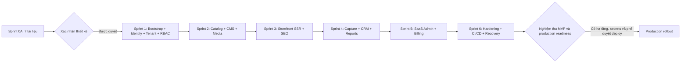

# SHOWORA — Development Roadmap & Stage Gates

Ngày: 02/11/2026 · Phiên bản: 0.2 · **Sprint 0 tài liệu đã bàn giao; nền tảng Sprint 1 đã triển khai local**.

> Trạng thái code thực tế: [báo cáo Sprint 1](SPRINT_1_REPORT.md). Những module chưa được liệt kê là thiết kế cho giai đoạn tiếp theo.
## 1. Quy tắc thực hiện

- Không triển khai tất cả trong một lần. Kết thúc mỗi giai đoạn phải báo cáo, cập nhật tài liệu và xử lý lỗi trước khi mở rộng phạm vi.
- Giai đoạn đầu đã bàn giao bảy tài liệu; người dùng đã xác nhận viết code. Monorepo bootstrap và nền tảng Sprint 1 đã triển khai. [Báo cáo Sprint 1](SPRINT_1_REPORT.md) ghi phạm vi đạt được và phần còn lại.
- Không tự thay kiến trúc đã được duyệt. Thay đổi cần phân tích vấn đề, phương án, ảnh hưởng security/data/ops và được xác nhận trước triển khai.
- Không dùng mock thay backend production, không bỏ validation/auth/authorization để tăng tốc. Fixture chỉ cho test hoặc demo opt-in, không tự bật ở production.
- Không đặt lịch/ước lượng cam kết khi chưa biết nguồn lực và acceptance baseline. Mỗi sprint kết thúc theo tiêu chí nghiệm thu, không chỉ theo ngày.

## 2. Dependency và approval gates

Trial/plan foundation phải có từ Sprint 1 để quota và expiry có nguồn dữ liệu; UI quản lý thương mại, invoice và coupon hoàn chỉnh ở Sprint 5. Lead capture chỉ được công bố hoạt động khi Sprint 4 hoàn tất; trước đó storefront không được hiển thị thông báo gửi thành công giả.

## 3. Sprint 0A — PRD, architecture, ERD và UI specification

**Đầu vào:** master prompt; workspace trống; chưa có nội dung sản phẩm TECHPLUS, secrets, domain/hạ tầng hoặc giá/quota được duyệt.

**Bàn giao:**

| File | Nội dung |
|---|---|
| `docs/PRD.md` | Vision, MVP/out-of-scope, personas, journeys, workflow, acceptance, expiry policy |
| `docs/ARCHITECTURE.md` | Mermaid system diagram, stack, tenant context, RLS, modules, monorepo, jobs và deployment strategy |
| `docs/DATABASE_ERD.md` | Mermaid ERD, data dictionary, FKs/unique/indexes, transaction và migration strategy |
| `docs/API_SPEC.md` | API modules, auth, permission/scope, routes, error/pagination/idempotency, realtime contract |
| `docs/SECURITY.md` | Threat model, risk assessment, controls, backup/incident response, security gates |
| `docs/DEVELOPMENT_ROADMAP.md` | Các sprint, dependencies, test matrix và format báo cáo |
| `docs/UI_UX_SPECIFICATION.md` | IA, shared component plan, tokens, screens, states và responsive/accessibility |

**Không có trong bàn giao:** application code, dependencies/lockfile, Prisma schema, migrations, API server, Docker/CI đã cấu hình hoặc deployment. Review tài liệu không thay unit/integration/E2E test.

**Exit gate:** đủ bảy tài liệu, liên kết nội bộ hợp lệ, scope và terminology nhất quán, Mermaid blocks có cấu trúc hợp lệ; báo cáo giới hạn kiểm chứng. Cần xác nhận bộ thiết kế trước Sprint 1.

## 4. Sprint 1 — Foundation, identity, tenant, RBAC và users

**Công việc:**

- Bootstrap pnpm workspace, pin Node LTS/pnpm, TypeScript strict, lint/typecheck/test/build scripts; admin Vite, storefront Next.js, API NestJS và các shared packages.
- Shared UI exports/tokens đầu tiên; app shell, login, registration/onboarding và permission-aware routes với đủ states.
- PostgreSQL/Prisma local và runtime/migration roles tách biệt; trusted host resolver và tenant transaction context.
- Email verification, Argon2id, JWT, rotation/revocation/reset; mời nhân sự, custom roles có delegation boundary, teams và last-owner invariant.
- Plan version/trial/usage anchors, entitlement service tối thiểu; chưa tự đặt giá/quota thương mại. Host/subdomain verified binding và domain lifecycle foundation.
- Health endpoints, log redaction, transactional outbox foundation, mail sandbox; secret/env validation.

**Migration dự kiến:** identity/account/session/tokens/onboarding/MFA storage; tenants/domains/members/invitations/roles/permissions/teams; plans/versions/subscriptions/usage/default website settings; audit/outbox foundation; SQL RLS/grants/indexes. Chia migration nhỏ theo dependency, không dùng runtime DB owner.

**API:** auth/account, tenant/members/invitations, roles/permissions/teams, domain resolver, subscription read, health; platform bootstrap qua ops, không public endpoint nâng quyền.

**Exit gate:** đăng ký/xác minh tạo tenant nhất quán, A/B isolation chạy bằng runtime DB role, refresh replay/revoke hoạt động, custom role không vượt quyền, owner cuối cùng được bảo vệ; frontend không tự cấp quyền.

## 5. Sprint 2 — Catalog, CMS và media

- Products/categories/brands, dynamic attribute builder typed, SEO và trạng thái xuất bản.
- Rich text sạch cho blog/pages; tags/category, schedule metadata; project/gallery và related products.
- Storage adapter, upload reservation/quarantine/validation/image optimization, folder/library và private download.
- Import XLSX validate-only → preview → commit theo batch; export an toàn; quota concurrency/reconciliation.
- Shared data table, forms, attachment field, filter toolbar, empty/error/loading states được tái sử dụng.

**Migration dự kiến:** CMS entities/joins/attributes/options/typed values/media/assets/reservations/folders, banners/settings/navigation/redirects; RLS và composite FK cho từng bảng; import/export job persistence.

**API:** Catalog/CMS/Media/Website theo API_SPEC; publish action chỉ cho permission publish.

**Exit gate:** CRUD thật, typed validation backend, không editor nào sửa tài nguyên tenant khác; quota không bị vượt bằng concurrent requests/import/upload; file độc hại không public; sanitize và SSR input an toàn. Không tạo sản phẩm TECHPLUS khi chưa có dữ liệu được cung cấp.

## 6. Sprint 3 — Public website, content và SEO

- Template responsive cho home/product listing/detail/blog/projects/contact; sections cấu hình theo tenant.
- Next SSR hostname-aware, metadata/canonical/Open Graph/JSON-LD, sitemap, robots và redirect 301.
- Search/filter/sort/pagination từ API thật, ba kiểu giá, preview signed token, cache invalidation tenant-aware.
- Custom domain DNS verification/routing/TLS end-to-end trên staging trước activate production.
- Analytics ingestion tối thiểu, consent/privacy notice, GA/GSC settings allowlist; chặn draft/private asset leak.
- Có thể dùng TECHPLUS opt-in chỉ với danh mục và tiêu đề draft đã cung cấp; banner cần nội dung/hình có nguồn trước publish.

**Migration dự kiến:** phần website/SEO/domain còn thiếu, analytics events/aggregates, preview token tracking nếu cần; không sửa phá schema Sprint 2.

**API:** Public website/content/SEO/analytics và preview. Lead form có thể được dựng nhưng giữ trạng thái “chưa bật tiếp nhận” cho đến Sprint 4, không tạo local fake success.

**Exit gate:** mobile + keyboard, HTML SSR chứa nội dung/meta đúng tenant, sitemap không lộ draft, cache không lẫn host; public tôn trọng tenant state; custom domain không activate trước ownership/TLS.

## 7. Sprint 4 — Lead capture, CRM, pipeline và notifications

- Public capture validation, consent, spam/rate limit, duplicate detection và idempotency.
- Lead list/detail, timeline, assignment, own/team/all policies; notes/activities/reminders/quotations và private attachments.
- Pipeline state machine, optimistic concurrency, expected/actual revenue, loss reason, audited reopen.
- Outbox deliveries, scheduler reauthorization, persistent notifications và Socket.IO room/session guards.
- Traffic/Lead/pipeline/source/product/Sale/revenue reports; thống nhất timezone/cohort/currency và permission scope.

**Migration dự kiến:** leads/sources/interests/assignments/activities/notes/reminders/status histories/quotations/attachments/duplicate candidates/idempotency, notification/delivery/report tables và RLS/indexes.

**API:** public capture, CRM, reports, notifications và socket contracts. Không có event tự join room hoặc socket mutation bypass REST.

**Exit gate:** form lưu DB thật → manager thấy và phân công → Sale nhận notification → chăm sóc/chốt → report khớp; Sale cũ mất quyền sau reassign; replay/job retry không tạo Lead hoặc notification lặp.

## 8. Sprint 5 — Super Admin, subscription và billing

- Platform dashboard, tenant activate/suspend/reactivate và resource usage; audience/platform guard riêng.
- Starter/Business/Professional có config và immutable plan versions; trial/grace/expired policy thống nhất.
- Invoice snapshot, change requests, coupon cơ bản, manual evidence/reconciliation, idempotent confirm/extension, platform audit.
- PaymentProvider abstraction; chưa thêm VNPay/MoMo giả lập. Owner recovery billing/export có allowlist khi expired.
- Hạ gói không xóa dữ liệu; quota check ở API/worker/scheduler/import; entitlement thay đổi invalidate cache/socket phù hợp.

**Migration dự kiến:** invoices/transactions/coupons/redemptions/platform audit/recovery export jobs và plan overrides nếu đã duyệt; seed cấu hình nghiệp vụ chỉ từ dữ liệu được chấp thuận.

**API:** platform/tenant billing/recovery. Không tự cấp CRM content access cho SUPER_ADMIN.

**Exit gate:** xác nhận thanh toán hai lần chỉ gia hạn một lần; amount/currency mismatch bị chặn; expiry/grace/recovery hoạt động; concurrent quota/coupon đúng; chỉnh plan không đổi retroactive invoice.

## 9. Sprint 6 — Testing, security, performance và deployment

- Hoàn thiện `docs/TESTING.md` và `docs/DEPLOYMENT.md` với lệnh/runbook đã chạy thực tế, env inventory không chứa secrets, staging/prod topology và chủ sở hữu vận hành.
- Docker multi-stage/non-root, Nginx/Cloudflare TLS/trusted proxy, GitHub Actions CI và gated deploy dev/main; configure protected branches bằng quyền repo khi có.
- Security scans/threat-model review, privileged MFA/step-up, penetration scenarios, CORS/CSRF/CSP/host/cache/media tests.
- Load profile có kích thước dữ liệu và phân bố tenant; đo p95/query plans, SSR performance và mobile accessibility. Không gắn nhãn đạt hiệu năng khi chưa đo.
- Backup DB/WAL/media offsite, isolated restore drill, health/monitoring/alerts, worker dead-letter/recovery, image rollback diễn tập với schema compatibility.
- Erasure/export retention và incident response/on-call; launch checklist có owner xác nhận, không tự deploy nếu chưa có môi trường/secrets/phê duyệt.

**Migration:** chỉ hardening/backfill/index cần thiết qua expand/contract; không destructive cleanup trước đo tác động.

**Exit gate:** ma trận bắt buộc dưới đây xanh, không còn Critical/High chưa xử lý, restore chứng minh mục tiêu, production readiness được ký duyệt. Một VPS không được quảng cáo HA.

## 10. Test strategy và ma trận nghiệm thu bắt buộc

Vitest cho shared validation/admin/storefront logic; Jest cho Nest services/policies; Supertest + PostgreSQL thật cho API integration; Playwright cho browser E2E. Dùng fixture riêng A/B, owner/manager/Sales trong nhiều team, runtime DB role có RLS; test DB/mailer/storage sandbox không thay production service bằng mock ở luồng nghiệm thu.

| # | Kịch bản từ brief | Cách kiểm chứng | Sprint |
|---|---|---|---|
| 1 | Tenant A không truy cập B | Supertest IDs/slug/joins/media/export + runtime RLS missing/wrong context/pool reuse; cache/socket/job cross-tenant | 1, mở rộng 2–6 |
| 2 | Sale không xem Lead ngoài scope | own/team list/detail/notes/reports/attachments; multi-team và reassignment; REST + socket | 4 |
| 3 | Không quyền không sửa sản phẩm | SALES/token thiếu permission gọi create/update/delete/publish/import, DB không đổi | 2 |
| 4 | Public form tạo Lead thành công | Playwright submit trên tenant host → API/DB/history/outbox đúng tenant; duplicate retry không thêm lần hai | 4 |
| 5 | Sale nhận notification | Assignment commit → inbox persisted + socket đúng người; reconnect lấy lại, không lộ sang người khác | 4 |
| 6 | Manager phân công được | Team manager assign thành viên hợp lệ; audit/history đúng; khác team hoặc tenant bị chặn | 4 |
| 7 | Sale cập nhật tiến trình | Allowed transition + note/reminder; invalid skip/WON thiếu revenue/LOST thiếu reason/version conflict bị chặn | 4 |
| 8 | Tenant hết hạn đúng chính sách | Fake clock ở test: trial end/grace/expired/suspended; API/public/worker/cache/recovery đồng nhất | 5 |
| 9 | Product limit hoạt động | Concurrent create/import ở sát quota, không vượt; rollback/retry/xóa/reconcile không đếm sai | 2, 5 |
| 10 | Website public tốt trên mobile | Playwright 360/390/768 px, listing/detail/form/menu; không tràn, keyboard/focus/labels, Lighthouse lab | 3, 6 |

Thêm tests theo rủi ro: refresh rotation/replay, reset revoke, privilege escalation, invoice replay, malicious file, stored XSS/CSRF, scheduler permission changes, outbox crash retry và backup restore. Không dùng test chỉ mirror implementation hoặc snapshot để thay business invariant.

## 11. CI/CD gates dự kiến

PR: pnpm frozen install → lint → typecheck → unit → PostgreSQL integration → build → Playwright core flows → security scans. Test secrets tách deployment secrets. Main/dev yêu cầu PR review và status checks; production deploy cần environment approval. Deploy chỉ sau build artifact đã kiểm tra, migration job có lock, health check và rollback plan.

Branch intent: `main` production; `dev` staging; `feature/*` development. Workspace đã khởi tạo Git trên `main`, remote `origin` là [Lastvegac/Showora](https://github.com/Lastvegac/Showora) theo yêu cầu người dùng. Chưa tạo nhánh `dev` hoặc cấu hình branch protections; push code không đồng nghĩa deployment production.

## 12. Mẫu báo cáo sau mỗi giai đoạn

1. Phạm vi đã hoàn thành và tiêu chí chưa đạt, tách tài liệu/UI/backend/ops.
2. File tạo/sửa kèm vai trò và liên kết.
3. Migration tạo/chạy, môi trường, backup/rollback implications; ghi “không có” nếu chưa làm.
4. API thêm/sửa với method/path/auth/permission; không gọi endpoint dự kiến là endpoint hoạt động.
5. Test/check đã chạy, lệnh, kết quả và giới hạn; không suy từ đọc code sang test pass.
6. Lỗi còn tồn tại, severity, owner và dependency cần cung cấp.
7. Hướng dẫn local đã kiểm chứng, env prerequisites không chứa secrets.
8. Documentation cập nhật và xác nhận cần thiết cho giai đoạn tiếp theo.

## 13. Cách xem bàn giao hiện tại và local dự kiến

Admin và API hiện chạy local bằng `pnpm dev`; PostgreSQL/Mailpit qua Docker. Xem [README](../README.md) để cài đặt và đăng ký tài khoản qua email local.

Scripts, ports, migrations và kiểm thử tenant isolation thực tế được ghi trong [báo cáo Sprint 1](SPRINT_1_REPORT.md), [TESTING](TESTING.md) và [DEPLOYMENT](DEPLOYMENT.md). Ownership transfer, MFA/platform admin và các controls vận hành nâng cao vẫn cần hoàn tất ở các bước tiếp theo.

## 14. Backlog chờ sau MVP

Round-robin; template builder mở rộng; VNPay/MoMo; automation và integrations; SSO; multi-instance API/socket adapter; advanced attribution. Mỗi mục cần PRD bổ sung, đo nhu cầu, đánh giá security và phê duyệt kiến trúc khi thay đổi. Không mở rộng sang e-commerce phức tạp trong phạm vi này.
