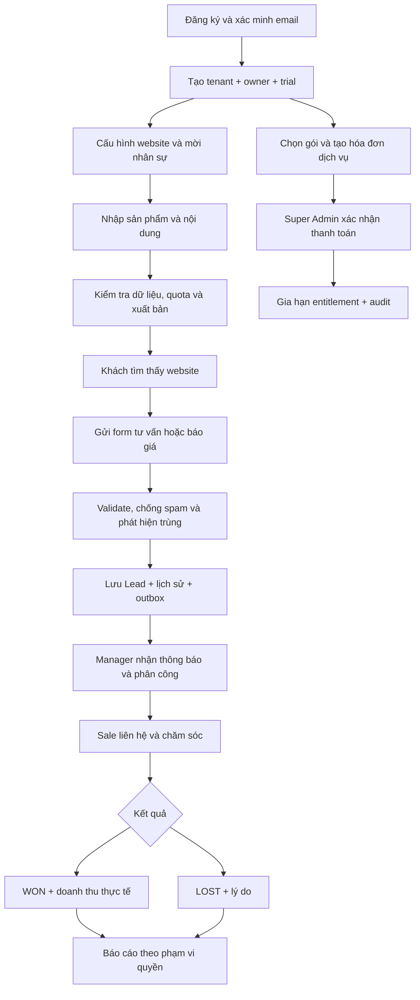

# SHOWORA — Product Requirements Document

Ngày: 02/11/2026 · Phiên bản: 0.2 · Trạng thái: **Thiết kế được dùng triển khai nền tảng Sprint 1; MVP chưa hoàn tất**.

> Trạng thái code thực tế: [báo cáo Sprint 1](SPRINT_1_REPORT.md). Những module chưa được liệt kê là thiết kế cho giai đoạn tiếp theo.
## 1. Mục tiêu và nguyên tắc

SHOWORA kết hợp Product Showcase, Marketing CMS, Lead Generation và Sales CRM cho doanh nghiệp B2B. Một doanh nghiệp có website giới thiệu riêng và không gian quản trị riêng trên cùng nền tảng. Giá trị cốt lõi là biến lượt quan tâm thành Lead có người chịu trách nhiệm và lịch sử chăm sóc đo được.

Khách hàng mục tiêu: nhà cung cấp máy phát điện, thiết bị công nghiệp, máy móc, thiết bị điện, nội thất và các doanh nghiệp B2B tương tự. Không xây giỏ hàng, thanh toán hàng hóa, quản lý kho hoặc ERP trong MVP.

Tài liệu này là yêu cầu và tiêu chí nghiệm thu, **không phải chứng nhận tính năng đã được triển khai**. Tất cả chính sách vận hành, mục tiêu hiệu năng và giới hạn nêu dưới đây là đề xuất cần được duyệt. Các giá trị thương mại chưa có nguồn phải được cấu hình trước khi mở bán.

## 2. Người dùng và công việc chính

| Người dùng | Công việc | Kết quả cần đạt |
|---|---|---|
| Khách truy cập | Tìm sản phẩm, so sánh thông tin, yêu cầu tư vấn | Gửi nhu cầu thành công trên mobile |
| TENANT_OWNER | Quản lý doanh nghiệp, nhân sự, gói dịch vụ | Kiểm soát website, chi phí và dữ liệu |
| TENANT_ADMIN | Cấu hình website, quản trị nhân sự được phép | Vận hành tenant không cần lập trình |
| CONTENT_EDITOR | Quản lý nội dung và media | Xuất bản đúng nội dung, đúng SEO |
| SALES | Chăm sóc Lead được giao | Ghi nhận tiến trình và lịch hẹn |
| SALES_MANAGER | Phân công và quản lý đội Sale | Không bỏ sót Lead, đo hiệu quả nhóm |
| SUPER_ADMIN | Quản lý tenant, gói và giao dịch dịch vụ | Vận hành SaaS có audit, không mặc định đọc CRM |

User là danh tính toàn cục; vai trò và permissions thuộc membership trong từng tenant. Một user có thể thuộc nhiều doanh nghiệp. SUPER_ADMIN là quyền nền tảng riêng, không tự động trở thành thành viên tenant.

## 3. Phạm vi MVP

| Nhóm | Trong MVP | Sau MVP |
|---|---|---|
| SaaS | Đăng ký, xác minh email, tenant/subdomain tự động, mời nhân sự, RBAC và custom roles có giới hạn cấp quyền | SSO doanh nghiệp, marketplace |
| CMS | Product/category/brand CRUD, thuộc tính động, gallery, SEO, import/export XLSX có báo lỗi từng dòng | Biến thể hàng hóa, PIM chuyên sâu |
| Nội dung | Bài viết draft/published/scheduled, dự án, page nội dung cơ bản | Workflow duyệt nhiều cấp |
| Website | Một template responsive có cấu hình section, menu, footer, nhận diện thương hiệu; domain riêng đã xác minh | Kéo thả tự do, nhiều template |
| Media | Upload ảnh/video theo allowlist, kiểm tra file, quota, tối ưu ảnh | Biên tập video, streaming/transcoding |
| CRM | Capture, chống spam/trùng, list/detail, pipeline, phân công, note, activity, reminder, báo cáo | Round-robin, automation nâng cao |
| Thông báo | In-app bền vững và cập nhật Socket.IO, email giao dịch cần thiết | SMS/Zalo OA, push mobile |
| SaaS admin | Tenant, kế hoạch giá có phiên bản, subscription, hóa đơn dịch vụ, xác nhận thanh toán thủ công, coupon cơ bản | VNPay/MoMo, kế toán và thuế tích hợp |
| Analytics | Page views hợp lệ, nguồn, phễu Lead, hiệu quả Sale và doanh thu CRM | Attribution đa chạm, BI nâng cao |
| SEO | SSR, metadata, canonical, sitemap, robots, structured data, redirect 301, cấu hình GA/GSC an toàn | Bộ công cụ SEO chuyên sâu |

MVP vẫn chia theo Sprint 0–6. Phạm vi trên không đồng nghĩa triển khai toàn bộ trong một lần. Báo giá trong CRM là bản ghi giá trị, trạng thái và tệp đính kèm; không bao gồm tạo hợp đồng, thu tiền hàng hoặc chữ ký điện tử.

## 4. Các yêu cầu chức năng và tiêu chí nghiệm thu

| ID | Yêu cầu | Tiêu chí nghiệm thu |
|---|---|---|
| SAAS-01 | Onboarding | Email được xác minh; tenant, domain, owner membership, trial và cấu hình khởi tạo được tạo nhất quán; retry không tạo bản ghi lặp |
| SAAS-02 | Cô lập tenant | Tenant A không đọc/ghi/liên kết dữ liệu B qua ID, slug, file, job, export, socket hoặc cache; có test âm tính |
| SAAS-03 | Nhân sự/RBAC | Chỉ cấp permission trong phạm vi người cấp; không tự nâng quyền; không xóa/hạ owner cuối cùng |
| SAAS-04 | Subscription | Trial, active, past_due, expired, suspended áp dụng đồng nhất ở API, worker và storefront; ghi vượt quota bị chặn nguyên tử |
| SAAS-05 | Domain | Subdomain unique; custom domain phải xác minh quyền sở hữu, TLS và binding; không phục vụ domain chưa xác minh |
| CMS-01 | Product | Có draft/published/archived, slug tenant-unique, ba kiểu giá và SEO; public chỉ nhận nội dung đã xuất bản |
| CMS-02 | Thuộc tính động | Tenant định nghĩa kiểu text/number/boolean/select, đơn vị, required và filterable; kiểm tra kiểu và lựa chọn ở backend |
| CMS-03 | Nội dung | Bài viết có rich text được làm sạch; scheduled publish chạy đúng thời điểm và đúng entitlement; dự án liên kết sản phẩm cùng tenant |
| CMS-04 | Media và XLSX | File sai loại/quá quota bị từ chối; import có preview/validation, kết quả lỗi từng dòng; export không gây spreadsheet injection |
| WEB-01 | Website | Home, danh sách/chi tiết sản phẩm, blog, dự án, contact; responsive; dữ liệu từ API thật |
| WEB-02 | SEO | HTML SSR có nội dung và meta riêng từng tenant; URL/canonical/sitemap không lẫn tenant; draft không xuất hiện |
| CRM-01 | Capture | Form hợp lệ tạo Lead, lịch sử ban đầu, assignment nếu có và notification qua transaction/outbox; phản hồi không lộ Lead đã tồn tại |
| CRM-02 | Phân quyền | Sale chỉ xem Lead được giao; manager chỉ xem Lead thuộc nhóm/phạm vi được cấp; cùng scope áp dụng cho báo cáo và tìm kiếm |
| CRM-03 | Chăm sóc | Status, note, lịch hẹn, reminder và quotation có lịch sử tác giả/thời gian; chống ghi đè khi cập nhật đồng thời |
| CRM-04 | Phân công | Chỉ chọn thành viên active hợp lệ; ghi lịch sử giao/thu hồi; Sale cũ mất quyền sau khi chuyển giao |
| CRM-05 | Báo cáo | Thống kê theo thời gian/sản phẩm/nguồn/Sale; số liệu tổng hợp đối chiếu được với tập Lead được phép xem |
| OPS-01 | Vận hành | Có CI, staging/prod riêng, HTTPS, health check, backup/restore đã diễn tập, monitoring và rollback |

## 5. Business workflow

### Pipeline và quy tắc chuyển trạng thái

Luồng chuẩn: `NEW → CONTACTED → QUALIFIED → CONSULTING → QUOTATION_SENT → NEGOTIATING → WON / LOST`.

- Sale được giao và có quyền cập nhật có thể tiến tới một trạng thái tiếp theo, hoặc LOST từ trạng thái mở. Không bỏ qua giai đoạn trong MVP.
- WON chỉ từ NEGOTIATING; yêu cầu `actualRevenue >= 0`, currency và thời điểm chốt. LOST bắt buộc lý do, không bắt buộc doanh thu.
- Manager có permission `leads.reopen` được mở lại WON/LOST về CONTACTED với lý do; không xóa lịch sử kết quả cũ.
- Khi reopen, xóa giá trị kết quả hiện hành (`closedAt`, `actualRevenue`, `lossReason`) trên Lead sau khi đã lưu snapshot lịch sử. Báo cáo kết quả chốt lấy lịch sử, pipeline hiện tại lấy trạng thái Lead; không cộng nhầm kết quả cũ như một thương vụ đang WON.
- Ghi `from`, `to`, tác giả, thời điểm, lý do trong cùng transaction. Dùng version để trả conflict khi hai người cập nhật cùng bản ghi.
- Giữ Lead mới chưa được giao trong hàng đợi manager/owner; không tự phân công giả hoặc làm biến mất khỏi dashboard.

## 6. User journeys

1. **Owner:** đăng ký → xác minh email → chọn subdomain → trial → cấu hình nhận diện → mời editor/manager → xuất bản sản phẩm → kiểm tra website → chọn gói → gửi bằng chứng thanh toán → xem gia hạn sau xác nhận.
2. **Khách:** tìm kiếm Google → trang sản phẩm SSR → đọc thông số có nguồn → nhập nhu cầu và thông tin liên hệ → đồng ý chính sách → thấy xác nhận gửi; không cần tạo tài khoản.
3. **Manager:** nhận thông báo → mở Lead chưa giao → kiểm tra trùng trong phạm vi quyền → chọn Sale của nhóm → theo dõi SLA liên hệ → xem phễu và lý do mất khách.
4. **Sale:** đăng nhập tenant → mở Lead được giao → cập nhật CONTACTED → thêm note/lịch hẹn → gửi báo giá ngoài hệ thống và ghi nhận → NEGOTIATING → WON/LOST.
5. **Editor:** tạo thuộc tính/danh mục/thương hiệu → upload media → tạo draft → kiểm tra preview và SEO → publish; không được vào CRM nếu thiếu quyền.
6. **Super Admin:** xem tenant và tài nguyên → xác minh thanh toán dịch vụ → gia hạn hoặc đình chỉ với lý do → kiểm tra audit; không truy cập nội dung khách hàng theo mặc định.

## 7. Dữ liệu và đo lường

- Không có dữ liệu nghiệp vụ hardcode trong frontend/backend. Gói Starter/Business/Professional là danh mục đề xuất; giá, quota, thời gian trial/coupon do nền tảng cấu hình trong DB, có version.
- TECHPLUS chỉ được khởi tạo như fixture/demo **opt-in**, tách production. Dữ liệu được cung cấp: tên TECHPLUS, ngành máy phát điện, sáu danh mục trong brief và tiêu đề bài “CUNG CẤP & LẮP ĐẶT MÁY PHÁT ĐIỆN 150 kVA TẠI ĐÀ NẴNG”. Bài này giữ draft vì chưa có nội dung thực tế được xác minh.
- Sáu danh mục: Máy phát điện Diesel; Máy phát điện xăng; Máy phát điện công nghiệp; Máy phát điện gia đình; Máy phát điện chống ồn; Phụ kiện.
- Chưa có sản phẩm/thông số/hình ảnh có quyền sử dụng/hotline/địa chỉ/khách hàng/dự án thực tế. Hiển thị empty state, không bịa dữ liệu hoặc đưa fixture vào production.
- Lead conversion rate = số Lead hợp lệ mới / số phiên truy cập hợp lệ trong cùng tenant và kỳ; công bố quy tắc loại bot/trùng, không đồng nhất page view với session.
- Win rate = số lần chốt WON / tổng lần chốt WON + LOST trong kỳ theo lịch sử trạng thái; report tách “kết quả chốt trong kỳ” và “cohort Lead tạo trong kỳ”.
- Revenue CRM là doanh thu thực tế khai báo trên Lead WON; không phải doanh thu subscription. Không cộng nhiều currency nếu chưa có quy tắc quy đổi; nhóm riêng theo currency.
- Lưu timestamp UTC; hiển thị/báo cáo theo timezone tenant, mặc định đề xuất `Asia/Ho_Chi_Minh`. Doanh thu dùng decimal/minor units, không dùng float.

## 8. Chính sách gói và hết hạn đề xuất

| Trạng thái | Website public | CMS/CRM | Khôi phục |
|---|---|---|---|
| TRIALING / ACTIVE | Hoạt động trong entitlement | Đọc/ghi trong quyền và quota | Owner quản lý gói |
| PAST_DUE, grace 7 ngày | Đọc được; tắt form tạo Lead | Chỉ đọc; dừng import/publish/job ghi nghiệp vụ | Owner thanh toán/gia hạn, export theo quyền |
| EXPIRED hoặc hết grace | Trang dịch vụ tạm ngưng, HTTP 503 | Chặn nghiệp vụ; chỉ truy cập recovery | Owner billing, export dữ liệu qua luồng recovery được kiểm soát |
| SUSPENDED | HTTP 503 | Chặn nghiệp vụ | Liên hệ hỗ trợ; export theo xử lý sự cố được duyệt |

Thời gian grace là cấu hình nền tảng có version, chưa phải điều khoản thương mại đã duyệt. Không tự xóa dữ liệu khi hết hạn. Hạ gói dưới usage hiện tại không xóa dữ liệu; chặn tạo mới vượt hạn mức, vẫn cho giảm usage và export hợp lệ. Lead capture quá quota phải báo tạm không tiếp nhận và giữ hotline nếu đã cấu hình, không trả thành công giả.

## 9. Yêu cầu phi chức năng và release gate

- TypeScript strict; pnpm duy nhất; không mock để giả chức năng production.
- Cô lập tenant và kiểm tra permission tại backend, bao gồm public data, search, export, media, realtime và worker.
- Mục tiêu thử nghiệm: p95 API đọc < 500 ms ở 50 request/giây trong kịch bản có dữ liệu và tenant phân bố được ghi rõ; không phải cam kết SLA trước benchmark.
- Storefront mục tiêu LCP ≤ 2,5 s, INP ≤ 200 ms, CLS ≤ 0,1 ở mobile; dùng lab trước launch, field data khi có lưu lượng.
- UI đáp ứng keyboard, focus, label/error và tương phản theo WCAG 2.2 AA ở các luồng chính.
- Mục tiêu vận hành ban đầu: availability 99,5%/tháng; RPO ≤ 1 giờ và RTO ≤ 4 giờ, chỉ công bố sau restore drill chứng minh được.
- Không còn lỗ hổng nghiêm trọng/cao chưa xử lý ở luồng auth/tenant/upload/payment; tất cả 10 kịch bản bắt buộc trong roadmap phải qua.

## 10. Điều kiện hoàn thành MVP

MVP chỉ hoàn thành khi onboarding, CMS, website SSR, SEO, capture lưu DB thật, phân công, chăm sóc, báo cáo, SaaS admin và subscription chạy xuyên suốt; tenant isolation có test; production có HTTPS, backup đã restore thử và monitoring. Giao diện riêng lẻ không đủ để nghiệm thu.

Đã triển khai nền tảng Sprint 1 sau xác nhận của người dùng. Xem [báo cáo triển khai](SPRINT_1_REPORT.md); việc triển khai local không đồng nghĩa đã nghiệm thu MVP hoặc production.

## 11. Thông tin cần chốt trước các bước phụ thuộc

| Cần xác nhận | Thời điểm cần | Mặc định đề xuất / ảnh hưởng |
|---|---|---|
| Phạm vi MVP, mô hình quyền và policy hết hạn | Trước Sprint 1 | Theo bộ tài liệu này |
| Domain gốc, email provider và hạ tầng | Trước onboarding staging | Host `*.showora.vn` chỉ là ví dụ; không coi là domain đã sở hữu |
| Giá, quota, trial và giới hạn upload | Trước mở bán | Không tự điền số liệu thương mại |
| Thời hạn lưu/xóa PII và điều khoản riêng tư | Trước nhận Lead thật | Chính sách phải cấu hình, có chủ sở hữu phê duyệt |
| Tài nguyên/nội dung TECHPLUS có nguồn | Trước xuất bản demo | Chưa có thì giữ draft/empty |
| Thanh toán, đối soát, hóa đơn pháp lý | Trước billing production | Xác nhận thủ công; chứng từ dịch vụ không mặc định là hóa đơn điện tử hợp pháp |

Tham chiếu: [Kiến trúc](ARCHITECTURE.md), [ERD](DATABASE_ERD.md), [API](API_SPEC.md), [Bảo mật](SECURITY.md), [Roadmap](DEVELOPMENT_ROADMAP.md), [UI/UX](UI_UX_SPECIFICATION.md).
